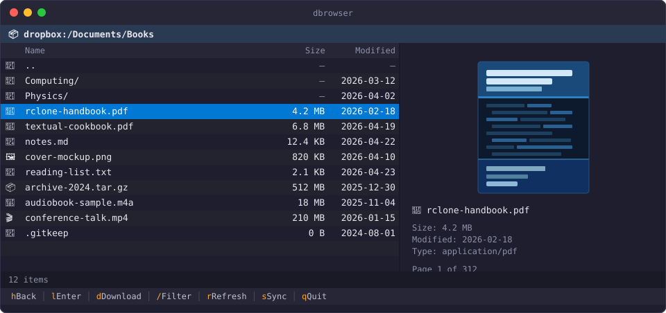

# dbrowser

A yazi-style terminal file browser for cloud storage remotes configured in [rclone](https://rclone.org/).

Browse your files interactively, preview files without downloading them, pull any folder to disk with a keystroke, and push local edits back on exit.

Supported backends: **Dropbox**, **Google Drive**, and **Amazon S3 / S3-compatible storage** (any rclone remote of type `dropbox`, `drive`, or `s3`). Remotes can have any name.

Target audience: Those who need to browse cloud files in a headless Linux server.



> **Disclaimer**
> This is an unofficial community project. It is not affiliated with, endorsed by, or sponsored by Dropbox, Inc., Google LLC, or Amazon Web Services. References to their services describe compatibility through `rclone`.

## Requirements

- Python 3.11+
- [rclone](https://rclone.org/install/) on `PATH`
- A terminal capable of rendering Unicode (most modern terminals)

## Install

```bash
curl -fsSL https://raw.githubusercontent.com/rsnemmen/dbrowser/main/install.sh | bash
```

The installer sets up [uv](https://docs.astral.sh/uv/) if needed, installs `dbrowser` in an isolated environment, and offers to install `rclone` if it is not already on your `PATH`.

## First run

`dbrowser` reuses supported remotes already configured in rclone. If none exist, it asks which backend to set up and launches `rclone config`. To set up S3 even when another backend is already configured, run `dbrowser --backend s3`.

### Dropbox

1. `n` — new remote
2. Name: anything (e.g. `dropbox`)
3. Storage: pick `dropbox` from the list
4. `client_id` / `client_secret`: leave blank (press Enter)
5. Edit advanced config? `n`
6. **Use auto config?** `n` — important for headless servers
7. On a machine with a browser, run the `rclone authorize "dropbox"` command rclone prints, then paste the token back.
8. Confirm and quit config (`q`).

### Google Drive

1. `n` — new remote
2. Name: anything (e.g. `gdrive`)
3. Storage: pick `drive` from the list
4. `client_id` / `client_secret`: leave blank for shared quota
5. scope: `drive.readonly` (or `drive` for full access)
6. Edit advanced config? `n`
7. **Use auto config?** `n` — important for headless servers
8. Follow the headless-auth instructions shown.
9. Confirm and quit config (`q`).

`dbrowser` will then launch its TUI.

### Amazon S3

If you previously configured an S3 remote with rclone, select it with `dbrowser --remote myaws` or use `dbrowser --backend s3`. Existing credentials and remote settings are reused automatically. `dbrowser` lets rclone resolve authentication; it does not read, copy, or store your secret keys.

If no S3 remote exists, run `dbrowser --backend s3` and follow the setup guidance:

1. `n` — new remote; choose any name (e.g. `myaws`).
2. Storage: `s3`; provider: `AWS` for Amazon S3.
3. Choose authentication:
   - Prefer `env_auth = true` with existing AWS runtime credentials, a configured AWS profile, or an IAM role. Leave `access_key_id` and `secret_access_key` blank. Temporary credentials must be valid for the session.
   - To save keys in rclone instead, choose `env_auth = false` and enter them in rclone's prompts. Temporary keys also need a `session_token` in advanced configuration.
4. Select the bucket's region. Leave the endpoint blank for AWS. Use advanced configuration if you need to select a named profile; alternatively set `AWS_PROFILE` before launching `dbrowser`.
5. Keep the remaining defaults unless your environment requires otherwise. Confirm the remote and quit config (`q`).

S3 authentication does not require an OAuth browser flow. For another S3-compatible service, select its provider and endpoint in rclone. See the [rclone S3 configuration and authentication documentation](https://rclone.org/s3/).

## Usage

```bash
dbrowser                                      # auto-detect; pick if multiple remotes
dbrowser --remote gdrive                       # go directly to a named remote
dbrowser --backend s3                          # select S3, or configure it if absent
dbrowser --backend s3 --path my-bucket/projects # start inside a bucket/prefix
dbrowser --remote myaws --path my-bucket        # use a specific remote and bucket
AWS_PROFILE=myprofile dbrowser --backend s3    # use a profile with runtime authentication
```

If multiple supported remotes are configured, `dbrowser` shows a numbered picker. `--backend` limits selection to that backend, and `--remote NAME` skips the picker. When combined, the remote must match the requested backend. An unknown explicit remote name produces an error; omit `--remote` to enter first-run setup.

`--path` accepts a directory relative to the selected remote, including `bucket/prefix` for S3; omit the remote name and `s3://` URL scheme. Surrounding slashes are removed. It works with all supported backends and selects the initial directory, rather than restricting navigation: `h` can still reach the remote root.

### S3 permissions, troubleshooting, and costs

At an S3 remote's root, the browser lists buckets; inside a bucket it lists objects and prefixes as files and folders. Root listing requires `s3:ListAllMyBuckets`. If your credentials grant access only to a known bucket or prefix, use `--path my-bucket/projects` to open it directly without first listing all buckets. Browsing needs `s3:ListBucket` for that location; previews and downloads need `s3:GetObject`. Sync also needs write/delete permissions. Keep access scoped to the intended buckets and prefixes; see [rclone's S3 permissions guidance](https://rclone.org/s3/#s3-permissions).

If discovery fails, `dbrowser` reports the configuration error instead of launching setup. If an existing remote fails to list, the browser displays the error and repair guidance. Check credentials or expired sessions, bucket/prefix permissions, and the configured region; use `rclone config` to repair the remote, then restart or refresh. Access errors do not automatically reopen setup. Archived objects may require restoration before preview or download; see [rclone's archive guidance](https://rclone.org/s3/#glacier-and-glacier-deep-archive).

S3 listings and metadata lookups issue requests; previews fetch object data, and downloads transfer it to your machine. Normal request, retrieval, and data-transfer charges can apply, including during sync checks. See [Amazon S3 pricing](https://aws.amazon.com/s3/pricing/). Prefer temporary credentials, HTTPS, and bucket encryption at rest; follow [AWS security best practices](https://docs.aws.amazon.com/AmazonS3/latest/userguide/security-best-practices.html) for bucket access and monitoring. `dbrowser` uses your rclone settings and does not change bucket policies or security settings.

### Keybindings

| Key             | Action                            |
|-----------------|-----------------------------------|
| `j` / `↓`       | next entry                        |
| `k` / `↑`       | previous entry                    |
| `g` / `G`       | jump to top / bottom              |
| `h` / `←`       | parent directory                  |
| `l` / `→` / `⏎` | enter directory                   |
| `d`             | download current folder (or file) |
| `s`             | sync all tracked downloads         |
| `/`             | filter current folder by name     |
| `Esc`           | clear filter                      |
| `r`             | refresh current listing           |
| `q`             | quit (triggers sync-back prompt)  |

### Preview

Text files render with syntax highlighting in the right-hand pane. Supported raster images (`png`, `jpg`, `jpeg`, `gif`, `webp`, `bmp`, `tiff`) render as a low-resolution terminal preview in the same pane; unsupported image types and oversized images fall back to metadata.

### Download

Pressing `d` opens a confirmation modal showing the remote path and a default local destination (`~/dbrowser-downloads/<remote>/<remote-path>`, editable). Downloading the root of a remote prints a size estimate and requires explicit confirmation — it won't happen by accident.

Progress is shown live; files stream to disk as they transfer. Press `Esc` in the progress modal to cancel an in-flight download.

### Startup sync check and sync back on exit

Downloaded folders stay tracked across launches in a small ledger at `$XDG_STATE_HOME/dbrowser/download-ledger.json` (or `~/.local/state/dbrowser/download-ledger.json` when `XDG_STATE_HOME` is unset).

When `dbrowser` starts, it dry-runs `rclone sync` for each tracked folder and only prompts you for folders with local changes that have not been pushed yet. Pressing `s` runs that same tracked-folder check on demand, and quitting with `q` runs it again for any tracked folders so edits made during the current session are caught too. In all cases, you choose **Sync** or **Skip** per folder, and can press `Esc` while a sync is running to cancel it.

Sync is **one-way: local → cloud remote**. Deletions on disk propagate to the configured remote. If you want bidirectional reconciliation, use `rclone bisync` manually — it's not wired in.

This includes S3: confirming a sync can upload changed files and delete corresponding objects. With read-only credentials, choose **Skip** rather than syncing.

## Architecture

- Single-process Python app using [Textual](https://textual.textualize.io/) for the TUI.
- Every cloud operation is an async `rclone` subprocess. No daemon; persistent state is limited to the tracked-download ledger.
- Listings stream in as background workers — the UI stays responsive even on slow connections.
- The download ledger is persisted on disk so startup and quit can both detect local edits to tracked folders.

Module layout:

```
src/dbrowser/
├── __main__.py     entry point
├── app.py          Textual App
├── browser.py      main browser screen (list + preview)
├── modals.py       download/sync modals
├── rclone.py       async rclone wrappers
├── config.py       first-run remote bootstrap and multi-remote picker
├── state.py        download ledger
├── preview.py      file preview rendering
└── progress.py     parse rclone --use-json-log output
```

## Development checks

```bash
pip install -e .
python -m py_compile src/dbrowser/*.py
python -m unittest discover -s tests -v
```

The automated tests use mocked rclone operations and Textual's headless browser; they require no cloud credentials. For live S3 verification, use a disposable prefix to check navigation, previews, downloads, and confirmed sync. See `CLAUDE.md` for manual smoke-test steps.

## Limitations

- One active remote per session — switching mid-session is not supported.
- Read-only on the remote: no rename, delete, or move. Edit locally and sync back instead.
- No on-disk cache — re-opening the tool re-fetches listings.
- Tracked download state is persistent, but remote listings are not cached across launches.
- Exit-sync is one-way (local → cloud); use `rclone bisync` manually for bidirectional.
- Unsupported binary files still show metadata only.
